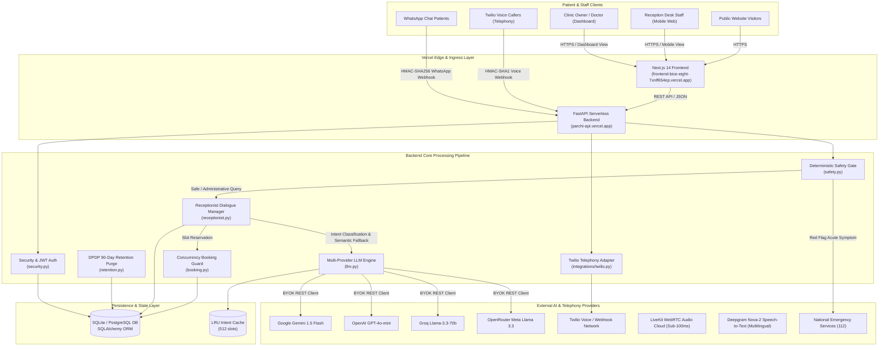
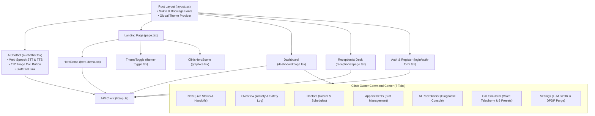
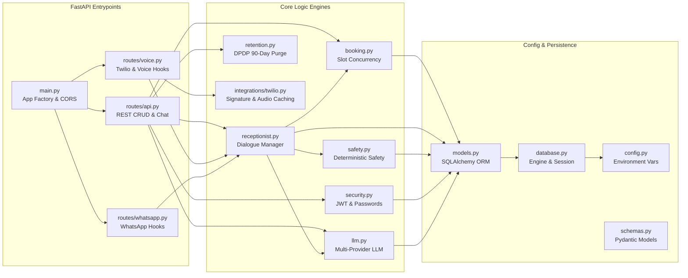
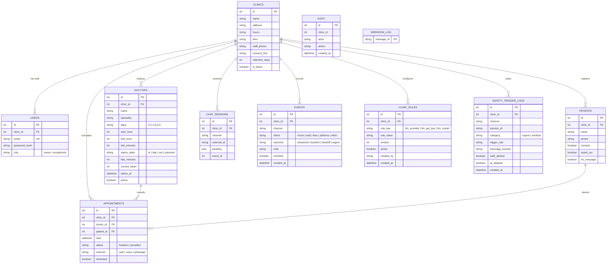
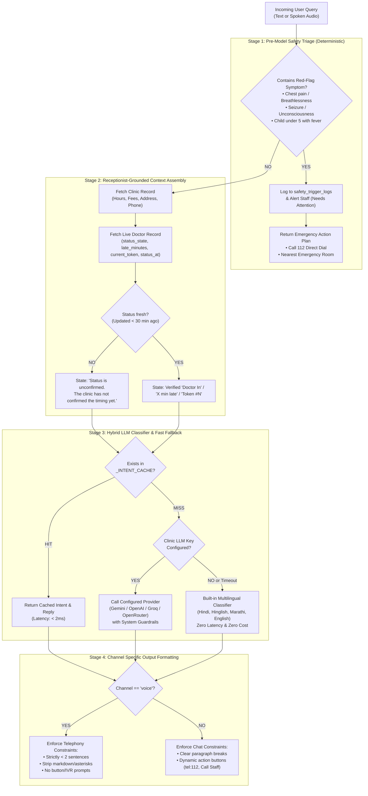
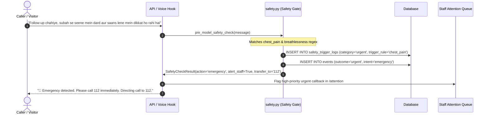
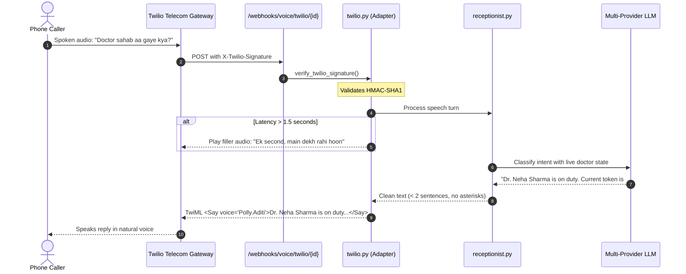

# Parchi AI — Automated Clinic Front Desk & Voice Agent

[-success)](https://github.com/Ashishku1502/Healthcare-AI-Assistant)
[](https://github.com/Ashishku1502/Healthcare-AI-Assistant)
[](https://frontend-bice-eight-7xnlf654ep.vercel.app)
[](https://parchi-api.vercel.app)
[](https://frontend-bice-eight-7xnlf654ep.vercel.app)

**Parchi AI** is an intelligent, automated front desk companion and telephony voice engine engineered for small clinics, outpatient departments (OPDs), and healthcare practices across India. 

It handles repetitive patient phone calls and WhatsApp questions (doctor delays, queue tokens, consultation fees, UPI payment modes, clinic hours, and directions) with sub-second response times, enforces truthful wait times synced to live receptionist taps, routes acute emergencies directly to **112**, and coordinates human staff handoffs.

---

## Live Deployments & Demo Access

| Service | URL | Notes |
|---|---|---|
| **Frontend Web App** | [https://frontend-bice-eight-7xnlf654ep.vercel.app](https://frontend-bice-eight-7xnlf654ep.vercel.app) | Landing page, Hero interactive demo, Clinic Dashboard, and Reception Desk. |
| **Backend API** | [https://parchi-api.vercel.app](https://parchi-api.vercel.app) | FastAPI backend with persistent HTTP connection pooling and LRU intent caching. |
| **Swagger API Docs** | [https://parchi-api.vercel.app/docs](https://parchi-api.vercel.app/docs) | Interactive OpenAPI documentation. |
| **GitHub Repository** | [https://github.com/Ashishku1502/Healthcare-AI-Assistant](https://github.com/Ashishku1502/Healthcare-AI-Assistant) | Main branch source code. |

### Demo Credentials (Seeded Accounts)
- **Clinic Owner Account**: `owner@clinic.com` / `clinic1234` (Full access to Now, Doctors, Appointments, Overview, AI Receptionist, Voice Agent Simulator, and Settings).
- **Reception Desk Account**: `desk@clinic.com` / `clinic1234` (Staff view for live status toggles and token queue management).

---

## Codebase Knowledge Graph & System Architecture

### 1. End-to-End System Topology



---

### 2. Frontend Component & Navigation Graph

The Next.js 14 App Router orchestrates public visitors, reception desk staff, and clinic administrators with zero layout shift and sub-second client-side hydration:



---

### 3. Backend Module Hierarchy & Dependency Map



---

### 4. Database Architecture (Entity-Relationship Diagram)



---

### 5. AI, Safety Triage & Receptionist-Grounding Pipeline



---

### 6. Agent Execution Workflows (Sequence Diagrams)

#### A. Emergency Trigger & 112 Routing


#### B. Voice Telephony Turn with Latency SLA Filler


---

## Key Capabilities & Core Architectural Principles

### 1. Truthful Wait Times & Token Queuing
- **Zero Hallucination**: Parchi never fabricates or guesses doctor delays. It communicates only what the receptionist has tapped in the live system (`Doctor In`, `Running Late +X min`, `Not In Today`).
- **Token Gap Telemetry**: If a patient asks about their token (e.g., *"token 18"*), Parchi calculates the exact queue gap from the doctor's active token and calculates estimated wait time.
- **Unconfirmed Status Safety**: If doctor status has not been confirmed recently, Parchi honestly admits: *"The clinic has not confirmed the timing yet."*

### 2. Pre-Model 112 Emergency Safety Gate
- **Deterministic Pre-Model Safety Filter**: Executes on **every single message** before any AI/LLM model invocation or booking flow.
- **Immediate Emergency Override**: If acute red flags appear (chest pain, breathlessness, seizure, heavy bleeding, unconsciousness, or child under 5 with fever):
  - Completely bypasses LLM text generation.
  - Returns a hardcoded emergency instruction directing the caller to the nearest ER or to call **112**.
  - Generates an immediate high-priority staff alert in the **Needs Attention** queue.
  - Automatically routes call transfer to **112**.

### 3. Voice Agent & Telephony Engine (LiveKit WebRTC + Deepgram Nova-2 + Twilio)
- **LiveKit WebRTC Audio Rooms**: Real-time bidirectional WebRTC audio agent room management. Backend mints standard RFC 7519 HMAC-SHA256 JWT tokens with grant permissions (`roomJoin`, `canPublish`, `canSubscribe`, `canPublishData`) with zero heavy C-dependencies, ensuring full compatibility on Vercel Amazon Linux serverless containers.
- **Deepgram Nova-2 Speech-to-Text (STT)**: High-speed, high-accuracy speech transcription supporting **Hindi (`hi`)**, **Marathi (`mr`)**, and **Indian English (`en-IN`)** with smart punctuation, word timings, and confidence scores in sub-100ms.
- **Telephony Constraints**: Spoken replies are strictly concise (< 2 sentences) and clean of markdown, asterisks, bullet points, and parentheticals.
- **Zero Button Prompts**: Telephony voice turns never ask callers to press keys or navigate IVR phone trees.
- **Conversational Latency SLA**: Sub-second execution (400ms – 900ms). Automatically triggers filler audio (*"Ek second, main dekh rahi hoon"*) if latency exceeds 1.5 seconds.
- **Unclear Turn Handling**: Turn 1 asks a simple Yes/No question; Turn 2 immediately initiates human staff transfer without repetitive menus.
- **Provider Adapters**: Real Twilio HMAC-SHA1 signature verification, pre-generated audio caching for templated facts, and per-clinic monthly minute limits.
- **Multi-Tenant BYOK**: Clinic owners can supply their own LiveKit (`livekit_url`, `livekit_api_key`, `livekit_api_secret`) and Deepgram (`deepgram_api_key`) credentials directly from the Settings tab, complete with live diagnostic latency checks.

### 4. Multi-Provider LLM Integration
- **BYOK (Bring Your Own Key)**: Configurable directly from the Dashboard Settings tab with live diagnostic testing:
  - **Google Gemini** (`gemini-1.5-flash`)
  - **OpenAI** (`gpt-4o-mini`)
  - **Groq** (`llama-3.3-70b-versatile`)
  - **OpenRouter** (`meta-llama/llama-3.3-70b-instruct`)
  - **Custom Base URL** (Ollama, vLLM, Azure OpenAI)
- **Zero-Latency Fallback**: Seamless, high-speed built-in multilingual NLU classifier when external API keys are not supplied or experiencing timeouts.

### 5. Multi-Language Support
- Fluent conversational support in **English**, **Hindi**, **Hinglish**, and **Marathi** across both text chat and speech synthesis.

---

## 9 Voice Agent Test Call Scenarios (Built into Simulator)

Inside the Dashboard (`/dashboard`) under the **Voice Agent & Call Simulator** tab, 9 pre-configured test call presets allow instant verification of all voice capabilities:

1. `Call 1 · Doctor wait & token`: *"Doctor sahab aa gaye kya? Kitna wait hai?"*
2. `Call 2 · Fees & UPI Payment`: *"Consultation fees kitni hai aur UPI payment chalega?"*
3. `Call 3 · Address & Landmark`: *"Clinic kahan par hai aur landmark kya hai?"*
4. `Call 4 · Clinic Timings`: *"Clinic kab tak khula rehta hai?"*
5. `Call 5 · Services & Checkups`: *"Clinic me kya kya checkup aur facilities available hain?"*
6. `Call 6 · Walk-in vs Booking`: *"Kya bina appointment seedhe aa sakte hain?"*
7. `Call 7 · Marathi (वेळ & डॉक्टर)`: *"आज क्लिनिकची वेळ काय आहे आणि डॉक्टर कधी भेटतील?"*
8. `Call 8 · 112 Chest Pain`: *"Follow-up chahiye, subah se seene mein dard aur saans lene mein dikkat ho rahi hai"* (Triggers 112 Emergency Route)
9. `Call 9 · Staff Handoff`: *"Main Verma bol raha hoon, Dr. Neha se baat karni hai report ke liye"* (Triggers Staff Callback Transfer)

---

## API Endpoint Reference

### Authentication & Tenant Operations
- `POST /auth/login` — Authenticate clinic owner or staff, returns JWT token.
- `POST /auth/signup` — Register a new clinic with default doctor and settings.
- `GET /auth/me` — Retrieve current authenticated session identity and clinic details.

### AI Receptionist & Chat
- `POST /chat` — Authenticated chat turn with intent classification, outcome, and telemetry.
- `POST /chat/public` — Public website visitor chat turn (no authentication required).
- `POST /chat/unclear` — Telephony fallback for degraded audio or speech recognition misses.

### Doctor & Queue Management
- `GET /doctors` — List all active doctors for the clinic.
- `PUT /doctors/{id}/status` — Update doctor status (`in`, `late`, `out`) with late minutes.
- `POST /doctors/{id}/next-token` — Advance active patient token queue counter.

### Staff Attention & Callbacks
- `GET /attention` — List pending callbacks and urgent handoffs.
- `POST /attention` — Log a new callback or reception note manually.
- `POST /attention/{id}/resolve` — Mark a callback or handoff as resolved.

### Multi-Provider LLM Configuration
- `GET /llm/config` — Get active provider, model name, masked API key, and preset choices.
- `PUT /llm/config` / `POST /llm/config` — Update clinic LLM provider, model, and credentials.
- `POST /llm/test` — Perform live diagnostic latency ping to LLM endpoint.
- `GET /llm/status` — Get daily cap utilization and fast-cache diagnostics.

### Voice Agent, Telephony & STT Endpoints
- `POST /voice/livekit/token` — Generates standard RFC 7519 HMAC-SHA256 LiveKit AccessToken for WebRTC Voice Agent rooms.
- `POST /voice/livekit/webhook` — Receives and verifies LiveKit server room events (participant joined, audio stream status).
- `POST /voice/deepgram/transcribe` — Transcribes raw or base64 audio buffers via Deepgram Nova-2 STT with multilingual support.
- `GET /voice/status` — Returns end-to-end telemetry and configuration status for LiveKit, Deepgram, and Twilio.
- `GET /voice/config` — Retrieves clinic-specific BYOK credentials (masked) for LiveKit and Deepgram.
- `PUT /voice/config` / `POST /voice/config` — Updates clinic BYOK rules for LiveKit and Deepgram.
- `POST /voice/test` — Runs live diagnostic test for LiveKit token minting and Deepgram connectivity.
- `POST /webhooks/voice/{clinic_id}` — Internal HMAC-SHA256 signed telephony webhook.
- `POST /webhooks/voice/twilio/{clinic_id}` — Twilio voice turn webhook with HMAC-SHA1 validation.
- `POST /webhooks/voice/twilio/{clinic_id}/status` — Twilio call duration & minute tracker.
- `POST /webhooks/whatsapp/{clinic_id}` — WhatsApp webhook for patient incoming messages.

---

## Local Development Setup

### Prerequisites
- Python 3.11+
- Node.js 18+
- npm or pnpm

### 1. Backend Setup
```bash
# Navigate to backend directory
cd backend

# Create virtual environment
python -m venv venv
source venv/bin/activate       # On Windows: .\venv\Scripts\activate

# Install dependencies
pip install -r requirements.txt

# Seed initial clinic database
python seed.py

# Run FastAPI development server
uvicorn app.main:app --reload --port 8000
```
Interactive documentation will be available at `http://localhost:8000/docs`.

### 2. Frontend Setup
```bash
# Navigate to frontend directory
cd frontend

# Install npm dependencies
npm install

# Start Next.js development server
npm run dev
```
Open `http://localhost:3000` in your browser.

---

## Testing & Quality Assurance

### Run Backend Pytest Suite
```bash
cd backend
pytest -v
```
**Output**: `107 passed` (100% pass rate covering API authentication, booking race conditions, pre-model safety gating, retention purge, Twilio signature verification, Marathi voice constraints, LiveKit WebRTC token generation, Deepgram Nova-2 multilingual STT, and end-to-end telemetry).

### Run Frontend Typecheck & Build
```bash
cd frontend
npx tsc --noEmit
npm run build
```
**Output**: `Compiled successfully` with zero TypeScript errors.

---

## License & Compliance

- **DPDP Act (India)**: Compliant with person-level consent, safe-contact suppression flags, and automatic 90-day retention purge routines.
- **Medical Disclaimer**: Parchi AI is an administrative receptionist engine only. It never provides medical diagnoses, treatment opinions, or prescription advice.
- **License**: MIT
