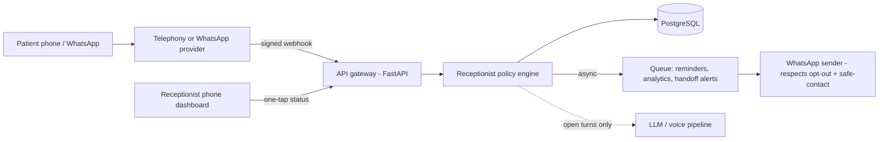

# System and data architecture (1 diagram + 1 page)

**Entities:** Clinic, User(role), Doctor(+live status), Patient(consent, opted_out, no_message), Appointment(unique active slot), ChatSession(pending state), Event(1 per contact, outcome, note), Audit.
**Synchronous:** policy decision, booking transaction, status read. **Async:** reminders, analytics roll-ups, alerts, provider retries.
**Live state:** `Doctor.status_state/late_minutes/status_at` set by the receptionist; stale after 90 min → "not confirmed".
**DPDP:** consent flag at first contact; opt-out/safe-contact enforced in sender; access by role + clinic; retention default 12 months then delete (decision owner: clinic owner); audit table for changes.
**Monday 9:30, 400 clinics:** ~82 concurrent calls (see cost sheet, mean-based estimate with 1.5× multiplier). Telephony channel limits are the first break; mitigate with pre-booked channel pool, templated audio (no model), per-clinic concurrency caps and graceful fall-back to "staff will call you back".
